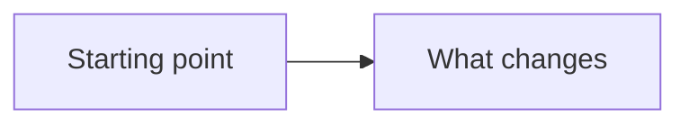

<!--
Skip preambles, keep prose brief, use GLOSSARY.md terms.
Screenshots: required if the PR changes anything a user sees (Qt windows, dialogs, plots, web pages).
Tests: required on every PR.
-->

## Summary

<!-- Start every PR summary with a Mermaid diagram. Replace the example labels with the actual change. -->

## Evidence

- **Before:** <output / failing test run>
  **After:** <output / passing test run>

### Screenshots

<!-- Required for UI changes: a before/after pair per changed view. Otherwise replace the table with "No UI change." -->

| Before | After |
| ------ | ----- |
|        |       |

### Tests

<!-- Required. Paste the command you ran and its summary line. A failing or skipped suite says why. -->

- **Local:** `<command>` → <N passed, N failed, N skipped>
- **CI:** <passing / failing / no CI>
- **Added or changed:** <test names, or "none" and why>

## Merge Danger

**Door:** <one-way or two-way>

<!-- optional: why -->

**Blast Radius:** <one word>

<!-- optional: what could break on merge (consumers, saved data, licenses, layout) -->
